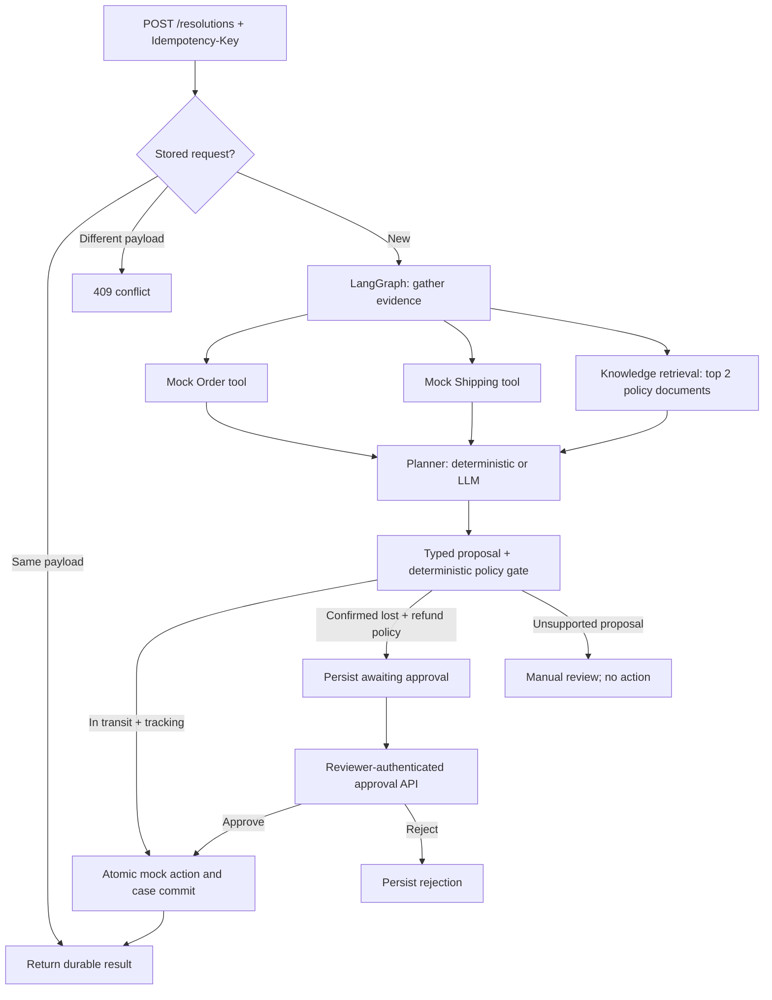

# Agentic Order Resolution

Order support workflow with a clear boundary between model recommendations and authorized actions.

A late package gets a tracking update. A carrier-confirmed lost package can be refunded after reviewer approval. A delivery dispute goes to manual review. Orders and policies are synthetic; external actions are recorded in a local ledger.

Python · FastAPI · LangGraph · Pydantic · SQLite · pytest

## Start here

1. Read [`graph.py`](src/order_resolution/graph.py): evidence → proposal → policy.
2. Read [`store.py`](src/order_resolution/store.py): transactional mock effects, durable receipts and approval transitions.
3. Run the three synthetic orders below.
4. Read [`test_resolution.py`](tests/test_resolution.py): concurrency, restart, outages, malformed model output and unauthorized approval.

The graph runs offline by default with a deterministic reference planner. An optional LLM adapter uses structured JSON output through an OpenAI-compatible chat-completions endpoint. The same server-side policy applies to both planners. This is a bounded agent workflow, not an autonomous general-purpose tool loop. The deterministic mode demonstrates orchestration and control boundaries; the optional mode adds model-based proposals grounded in retrieved policy text.

## Architecture



LangGraph owns evidence gathering, planning and policy validation. The service owns durable case transitions and execution. Human review is an explicit persisted state followed by a separate endpoint, rather than an in-memory wait or a LangGraph `interrupt`. No worker stays occupied while a human decides.

## Quick start

Requires Python **3.11+**. Run from this folder:

```bash
python3 -m venv .venv
source .venv/bin/activate
python -m pip install -r requirements.txt
export REVIEWER_TOKEN="$(python -c 'import secrets; print(secrets.token_urlsafe(32))')"
uvicorn order_resolution.api:app --host 127.0.0.1 --port 8000
```

Keep the generated token in the same shell for the approval examples. For a second terminal, set the same token there. `.env.example` documents configuration; it is not loaded automatically. Without a reviewer token, the approval endpoint returns 503. Default database: `./demo.db`. Use one worker; do not expose this demo to the internet.

Interactive API documentation: [localhost:8000/docs](http://localhost:8000/docs).

```bash
pytest -q
ruff check .
ruff format --check .
```

`requirements.lock` pins the locally tested environment; `pyproject.toml` declares package dependencies and compatible ranges. `requirements.txt` installs the locked dependencies and this project in editable mode. CI runs the same checks on Python 3.11 and 3.13.

## Try the scenarios

| Order | Synthetic carrier evidence | Expected default result |
|---|---|---|
| ORD-1001 | In transit, two days late | Completed mock tracking update |
| ORD-1002 | Carrier-confirmed lost, total 8900 cents | Awaiting human approval for full refund |
| ORD-1003 | Delivered | Manual investigation, no action |

### Safe automatic action

```bash
curl -s http://localhost:8000/resolutions \
  -H 'Content-Type: application/json' \
  -H 'Idempotency-Key: tracking-demo-001' \
  -d '{"order_id":"ORD-1001","issue":"Where is my late delivery?"}'
```

A representative response (IDs vary):

```json
{
  "case_id": "<uuid>",
  "order_id": "ORD-1001",
  "status": "completed",
  "proposal": {
    "action": "tracking_update",
    "rationale": "Carrier status: in_transit.",
    "evidence_ids": ["delivery-v1", "delivered-v1"]
  },
  "amount_cents": 0,
  "receipt": "<uuid>",
  "error": null
}
```

Replay the same request and key: the stored case and receipt are returned. Reuse that key with a different body: HTTP 409. A different key for the same order/action reuses the existing action receipt.

### High-risk action

```bash
curl -s http://localhost:8000/resolutions \
  -H 'Content-Type: application/json' \
  -H 'Idempotency-Key: refund-demo-001' \
  -d '{"order_id":"ORD-1002","issue":"My shipment is missing; can I get a refund?"}'
```

Copy `case_id` from the response:

```bash
CASE_ID='paste-case-id-here'
curl -s "http://localhost:8000/resolutions/$CASE_ID"
curl -s "http://localhost:8000/resolutions/$CASE_ID/approval" \
  -H 'Content-Type: application/json' \
  -H "Authorization: Bearer $REVIEWER_TOKEN" \
  -d '{"approve":true}'
```

Use `{"approve":false}` to reject a pending case. Repeating the same final decision is idempotent; reversing a final decision returns 409. A refund amount is derived from the trusted order tool, never from model output or an approval payload.

### Manual investigation

```bash
curl -s http://localhost:8000/resolutions \
  -H 'Content-Type: application/json' \
  -H 'Idempotency-Key: delivered-demo-001' \
  -d '{"order_id":"ORD-1003","issue":"Delivery marked delivered but not received"}'
```

Manual-review cases cannot be approved through the refund endpoint. A real case-management workflow would handle them separately.

## Optional LLM mode

Choose a provider and model that support `response_format: json_schema` for chat completions:

```bash
export PLANNER_MODE=llm
export LLM_BASE_URL=https://your-provider.example/v1
export LLM_MODEL=your-structured-output-model
export LLM_API_KEY=your-local-key
```

Restart the server and use fresh idempotency keys. The adapter sends only synthetic demo evidence and the submitted issue text. It performs no arbitrary tool execution. Local tests exercise the adapter with mocked HTTP responses; a paid/live provider call has **not** been verified. Model recommendations can vary, including a conservative manual-review result.

## Design decisions

| Decision | Why it matters | Deliberate boundary |
|---|---|---|
| Separate proposal from authorization | A persuasive model response is not permission to spend money | Closed action set, carrier-status checks, required loss-policy citation, server-derived amount |
| Structured state and output | A reviewer can inspect every handoff; malformed model output fails safely | Typed graph state; Pydantic validation at API/model boundaries |
| Small retrieval-augmented planner | Retrieved policy IDs make the evidence trail inspectable | Lexical top-2 retrieval, not embeddings; citations verify provenance, not semantic truth |
| Durable explicit review state | Pending refunds survive restarts without occupying a worker | SQLite stores the result, not every LangGraph node checkpoint |
| Two levels of idempotency | HTTP retries and duplicate business requests are different problems | Request key + payload hash; semantic action key `order:action:v1` |
| Atomic mock effects | A mock action and its case record commit together | This is a database ledger, not a payment, email or carrier network call |
| Bounded retry | Retry transient reads, not unclassified business failures | Three attempts per read tool, 0.5 s each; LLM two attempts, 10 s each; capped exponential delay |
| Minimal observability | See tool latency/attempts and policy decisions without logging issue text or credentials | JSON application logs; no tracing backend or metrics service |

Retries cover timeouts, transport errors, and model HTTP 429/5xx. Non-transient provider errors or invalid model JSON produce a persisted `failed` result and no side effect. A `failed` result is HTTP 200 with a typed failure status; callers must inspect `status`. Its request key remains bound to the failure: explicitly retry with a new key after recovery. Unknown orders are 404; invalid inputs are 422.

The semantic key intentionally allows only one mock action of each type per order and policy version. That makes duplicate prevention easy to review, but would suppress future legitimate tracking updates; a real system needs event/version-scoped keys. Rejecting one case also does not permanently prohibit a different case for that order; it still requires a new human approval.

## Validation

The test suite covers:

- Safe tracking action, request replay, payload conflict and business-level deduplication.
- Reviewer authentication, disabled approval without configuration, rejection and terminal-state conflicts.
- Concurrent request replays and concurrent approvals producing one durable action receipt.
- Restart persistence of pending cases and completed receipts.
- Missing orders, invalid input, transient retries, deadline exhaustion and tool outages.
- Invented evidence and policy-incompatible model proposals taking no automatic action.
- Mocked LLM structured output, invalid action names and malformed provider envelopes.

## Limitations and production evolution

This application is intended for local demonstration. It has no customer authentication or tenant/ownership checks, no genuine payment/shipping/email effects, no live order refresh at approval, no cancellation endpoint, and no open-ended reasoning loop. A bearer token demonstrates an approval boundary; it is not a production identity system. The policy catalog and retrieved content are fixed local data. Prompt-injection defenses rely on hard action/policy boundaries, not the system prompt alone.

SQLite calls are synchronous and the process-wide async lock serializes new requests while the graph runs. Run one process and one worker. Horizontal scaling and crashes across multiple service processes are not supported by this orchestration design. Within this process, a database transaction atomically records mock side effects and results; this does not promise exactly-once delivery to external systems.

A production implementation should evolve in this order:

1. **Identity and ownership:** authenticated customers, scoped reviewer roles, tenant isolation, signed/audited approval decisions and retention rules.
2. **Execution boundary:** provider idempotency tokens, a transactional outbox, reconciliation of ambiguous network outcomes, and fresh order/eligibility checks at approval.
3. **Durable orchestration:** PostgreSQL, per-case locking/leases, background workers and versioned checkpoints; deadlines across the entire workflow.
4. **Evidence quality:** versioned policy snapshots, semantic retrieval, evidence relevance evaluation, and expiry/revalidation for old approvals.
5. **Evaluation and operations:** labeled scenario corpus, adversarial input/model tests, quality/cost/latency budgets, tracing, alerting and rollout gates.

These items are not implemented yet.

## Repository map

```text
src/order_resolution/
  api.py        # HTTP boundaries, reviewer auth, JSON logs
  graph.py      # LangGraph workflow and deterministic authorization policy
  planner.py    # Offline planner + optional structured-output LLM adapter
  tools.py      # Mock reads, retrieval, timeout/retry wrapper
  store.py      # SQLite cases and transactional mock action ledger
  models.py     # Validated request/proposal/result contracts
  data/         # Original synthetic orders and policy documents
tests/          # Behavioral, concurrency and failure tests
```

## References

Implementation uses the [LangGraph graph API](https://docs.langchain.com/oss/python/langgraph/graph-api) and [FastAPI lifespan testing pattern](https://fastapi.tiangolo.com/advanced/testing-events/).

## License

MIT; see [LICENSE](LICENSE).
